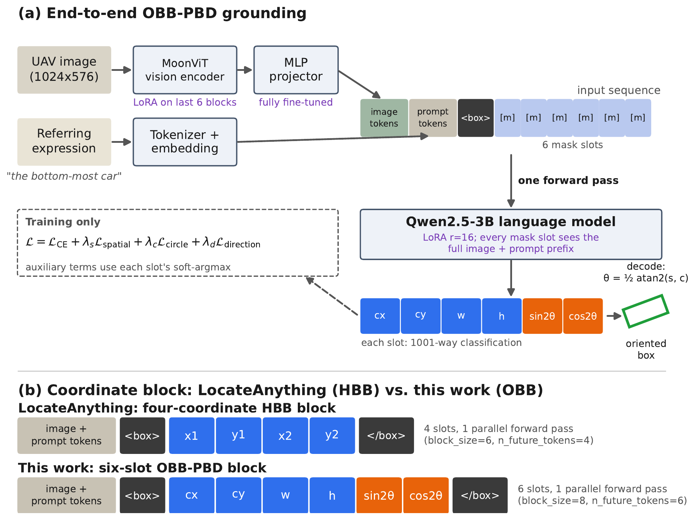
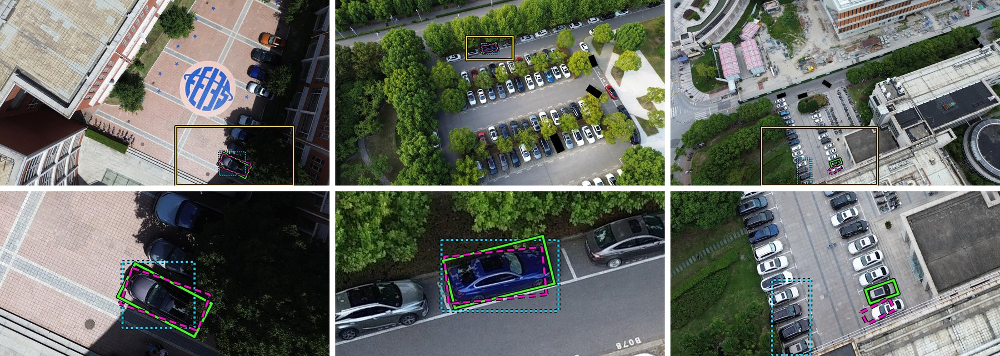

# OBB-PBD: Oriented Bounding Boxes with Parallel Box Decoding

Code, training configuration, evaluation protocol and trained checkpoints for

> Chang Woo Song and Yeong Jun Koh. **OBB-PBD: Extending Parallel Box Decoding to Oriented Bounding Boxes for Referring Expression Grounding in Aerial Imagery.** *Remote Sensing* (MDPI), accepted 2026.

OBB-PBD extends the Parallel Box Decoding (PBD) interface of [LocateAnything-3B](https://huggingface.co/nvidia/LocateAnything-3B) from a four-coordinate horizontal box to a six-slot oriented box `<box> cx cy w h sin2θ cos2θ </box>`. All six coordinate tokens are predicted in one forward pass of the language model, and the angle is recovered with a double-angle parameterization.



## Results

Complete AVVG test split (6,139 records, 120 images). OBB-PBD is reported as mean ± standard deviation over three training seeds; checkpoint selection uses a held-out validation split that is disjoint from the test images.

| Model | rotIoU | aabbIoU | Acc@0.75 |
|---|---|---|---|
| LocateAnything-3B, zero-shot (horizontal boxes) | 0.1253 | 0.1512 | 3.3% |
| **OBB-PBD (ours)** | **0.303 ± 0.012** | **0.334 ± 0.012** | **22.0%** |

Learning the oriented box instead of its axis-aligned envelope adds **+0.055 ± 0.008 rotIoU** over a matched control trained on the same data, decoder and budget; expanding the block from four to six slots alone adds no rotIoU gain distinguishable from zero. Per-seed values and 95% image-cluster confidence intervals are in `experiments/analysis/SEED_TABLES.json`.



Green solid: ground truth. Magenta dashed: OBB-PBD (seed 1). Cyan dotted: the zero-shot LocateAnything-3B baseline (axis-aligned). All outlines are drawn over a black border for visibility. Prompts: (a) "the bottom-most car", OBB-PBD rotIoU 0.82; (b) "the blue bmw mid-size car in the top-middle", 0.79; (c) "the brown skoda suv car in the bottom-middle", 0.00 for both models, which place a well-formed box on a neighboring car. The examples were selected to illustrate these behaviors, not sampled at random.

## Repository layout

| Path | Contents |
|---|---|
| `src/obb_pbd/` | dataset, collator, losses, metrics, splits and reporting code |
| `scripts/` | data download, split manifest, training, checkpoint selection, evaluation, diagnostic probes, latency, paper tables and figures |
| `patches/LocateAnything-3B/` | required corrections to the backbone's remote code (see below) |
| `configs/upstream.json` | pinned backbone revision |
| `experiments/` | per-record predictions and summaries behind the paper's tables (`obb_pbd/`, `hbb_controls/`, `analysis/`), and the split manifest |
| `tests/` | unit tests (CPU) |
| `environment/` | package inventory (`pip freeze`), Python version and GPU inventory captured from the training container |
| `assets/` | figures used in this README (from the paper) |
| `AGENTS.md` | guide for AI assistants asked to explain or run this repository (`CLAUDE.md` imports it) |

## Setup

The scripts assume the repository is at `/workspace` inside a container built from the `Dockerfile` (PyTorch 2.5.1, CUDA 12.1). Training used Python 3.11.10, PyTorch 2.5.1+cu121, Transformers 4.57.1 and PEFT 0.20.0 on 3 × NVIDIA RTX 6000 Ada (48 GB); the package inventory recorded at the start of training is in `environment/` (an inventory, not a lockfile; see `environment/README.md`).

```bash
pip install -e ".[dev]"
python -m pytest -q          # CPU tests; GPU/torch tests are skipped without torch
```

### Data and backbone

```bash
# AVVG subset of RefGeo (S-Lab License 1.0)
python scripts/fetch_refgeo_metainfo.py --subset avvg
python scripts/fetch_avvg_images.py
# LocateAnything-3B at the pinned revision (NVIDIA License)
python - <<'PY'
from huggingface_hub import snapshot_download
snapshot_download("nvidia/LocateAnything-3B", revision="c32291ca5e996f5a7a485845b4f57a233936bba0",
                  local_dir="/workspace/models/LocateAnything-3B")
PY
```

### Backbone patch (required)

The released remote code computes the training-time causal prefix from a position-ID pattern that training never produces, so the coordinate slots cannot see the image or prompt while the training loss still decreases. Four further defects crash training or evaluation. Apply the patch before training or evaluating:

```bash
cd /workspace/models/LocateAnything-3B
patch -p1 < /workspace/patches/LocateAnything-3B/combined.diff
sha256sum modeling_locateanything.py modeling_qwen2.py generate_utils.py mask_sdpa_utils.py
# compare with the "patched=" values in patches/LocateAnything-3B/SOURCE_FILE_HASHES.txt
rm -rf ~/.cache/huggingface/modules/transformers_modules/LocateAnything_hyphen_3B
```

`scripts/probe_block_visibility.py` checks the fix: the first coordinate slot should see all 894 keys of a training sequence, not 7.

## Training and evaluation

The data split (421 training images, 74 validation images, 120 test images) is fixed by `experiments/obb_pbd/split_manifest.json`. The launchers rebuild the split from the official RefGeo metadata and stop if it is not byte-identical to this file (its SHA-256 is fixed in the launcher).

One OBB-PBD seed (training, validation-based checkpoint selection, full-test evaluation, image-cluster bootstrap):

```bash
SOURCE_COMMIT=$(git rev-parse HEAD) OBBPBD_SEED=20260812 OBBPBD_SAMPLER_SEED=0 \
OBBPBD_RUN_ROOT=/workspace/runs/obb_s1 OBBPBD_CKPT_DIR=/workspace/runs/obb_s1/ckpt \
bash scripts/run_obb_pbd.sh
```

Seeds 1–3 in the paper use `OBBPBD_SEED` 20260812–20260814 with `OBBPBD_SAMPLER_SEED` 0–2. The matched controls use `scripts/run_hbb_controls.sh` with `OBBPBD_ARMS=HBB_ENVELOPE` or `HBB_PBD` and their own `OBBPBD_RUN_ROOT`, `OBBPBD_ENVELOPE_CKPT` and `OBBPBD_PBD_CKPT`.

**Always set `OBBPBD_RUN_ROOT` (and the checkpoint folders) to a new location.** The launchers' defaults are the original run folders under `experiments/`, which in this repository hold the shipped results; the launchers refuse to overwrite existing checkpoints, but not other files in a run folder.

The settings match the paper (Table 1): AdamW (weight decay 0.01), constant learning rate 1e-4 (projector 1e-5), no warmup, batch size 1 per GPU with gradient accumulation 4 on 3 GPUs (global batch size 12), bfloat16, gradient clipping 1.0, 5 epochs. A run on a different number of GPUs changes the data order and is not directly comparable with the reported seeds.

### Reproducing the tables without a GPU

The per-record test predictions of every reported run are in `experiments/`.

```bash
# Tables 2-3 and A2-A3: per-seed metrics, decomposition steps and image-cluster CIs.
# Rewrites experiments/analysis/SEED_TABLES.json (identical to the shipped file).
python scripts/seed_tables.py
# Section 4.3: where the image-shuffled residual comes from (seed 1)
python scripts/analyze_shuffle_residual.py \
  --probe experiments/analysis/OBB_FULL_TEST_IMAGE_DEPENDENCE.predictions.jsonl \
  --full-test experiments/obb_pbd/OBB_FULL_TEST.predictions.jsonl \
  --out /tmp/shuffle_residual_s1.json
```

For Table 4 (image dependence), all three conditions for seed 1 are in `experiments/analysis/OBB_FULL_TEST_IMAGE_DEPENDENCE.json` (with the image-shuffled predictions), and the image-shuffled results for seeds 2 and 3 are in `SHUFFLE_RESIDUAL_s2.json` and `SHUFFLE_RESIDUAL_s3.json`.

## Checkpoints

The LoRA adapters (language model, last six MoonViT blocks, and the fully trained `mlp1` projector) of all nine trained runs — OBB-PBD and the two matched controls, three seeds each — will be released on the Hugging Face Hub at **https://huggingface.co/ce-dric/OBB-PBD**. They are loaded on top of the patched backbone at the pinned revision.

## License

The code and checkpoints are derivative works of LocateAnything-3B and are distributed under the **NVIDIA License** (`LICENSE`): non-commercial research and evaluation use only. The patch in `patches/` modifies files of the LocateAnything-3B remote code; the changes are described in `patches/LocateAnything-3B/README.md`.

**Improved using Qwen.** The language model of LocateAnything-3B is based on Qwen2.5-3B-Instruct, licensed under the Qwen RESEARCH LICENSE AGREEMENT (`licenses/QWEN_RESEARCH_LICENSE.txt`).

The AVVG data come from RefGeo (Copyright 2023 S-Lab), distributed under the S-Lab License 1.0 (`licenses/REFGEO_S-LAB_LICENSE.txt`). The shipped prediction files contain target boxes derived from its annotations and are redistributed for non-commercial use under that license. See `NOTICE` for all attribution notices.

## Citation

If you use this code or the checkpoints, please cite the paper:

```bibtex
@article{song2026obbpbd,
  author  = {Song, Chang Woo and Koh, Yeong Jun},
  title   = {{OBB-PBD}: Extending Parallel Box Decoding to Oriented Bounding Boxes for Referring Expression Grounding in Aerial Imagery},
  journal = {Remote Sensing},
  year    = {2026},
  note    = {Accepted; volume, pages and DOI to be added}
}
```
